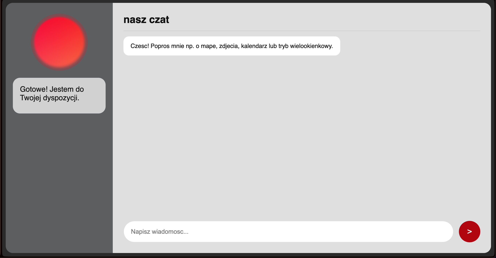
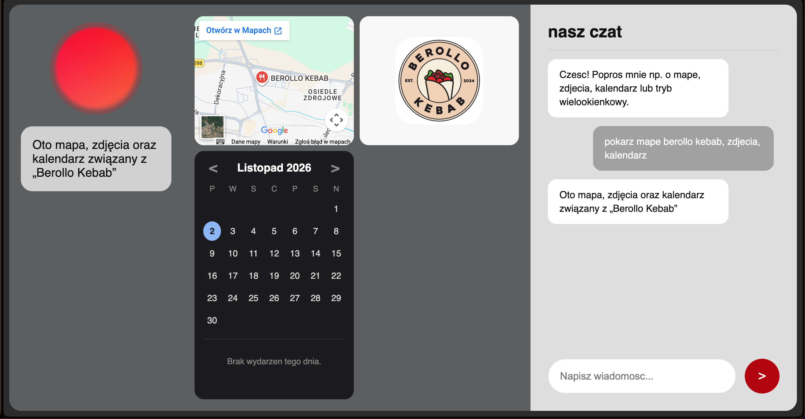

# 🤖 EVA - Twój Cyfrowy Asystent AI

EVA to inteligentny, w pełni lokalny asystent głosowy i tekstowy, stworzony z myślą o systemach **macOS, Windows i Linux**. Projekt łączy w sobie nowoczesny interfejs graficzny z potęgą modeli językowych (LLM) oraz syntezy mowy (TTS), pozwalając na naturalną rozmowę, zarządzanie notatkami, kalendarzem oraz wyszukiwanie informacji w internecie.

---

## 📸 Zrzuty ekranu

*(Zobacz, jak EVA prezentuje się w akcji!)*

### Główny interfejs


### Tryb wielookienkowy (Mapa, Zdjęcia, Kalendarz, Notatki)


---

## ✨ Główne funkcje

- **🗣️ Interakcja głosowa**: Rozpoznawanie mowy (STT) dzięki modelowi Whisper oraz naturalna synteza mowy (TTS) w języku polskim.
- **🪟 Tryb wielookienkowy**: Możliwość jednoczesnego wyświetlania mapy, zdjęć, kalendarza i notatek w dedykowanym panelu.
- **📅 Kalendarz i Notatki**: Wbudowany, w pełni interaktywny system zarządzania czasem i zapisywania myśli.
- **🌐 Wyszukiwanie w sieci**: Błyskawiczne odpowiadanie na pytania o pogodę, newsy czy wyniki meczów.
- **💻 Kontrola systemu**: Otwieranie i zamykanie aplikacji za pomocą poleceń głosowych (np. *"Otwórz Chrome i Spotify"*).
- **🎨 Personalizacja**: Ekran powitalny (Onboarding) z lektorem i wybór jednego z 4 motywów kolorystycznych.
- **📱 Responsywność**: Interfejs dostosowuje się do ekranu komputera, a także telefonu (z obsługą mikrofonu przez HTTPS).

---

## 🛠️ Wymagania

- **Python 3.10** lub nowszy.
- System operacyjny: macOS, Windows lub Linux.
- **Klucz API Groq** (darmowy plan w zupełności wystarczy). Możesz go wygenerować na [console.groq.com](https://console.groq.com/keys).

---

## 🚀 Instalacja i uruchomienie

1. **Sklonuj repozytorium:**

   ```bash
   git clone https://github.com/J2014C/EVA.git
   cd EVA
   ```

2. **Zainstaluj wymagane biblioteki:**

   ```bash
   pip install fastapi uvicorn groq edge-tts python-multipart requests ddgs beautifulsoup4 cryptography
   ```

3. **Uruchom aplikację:**

   Dla **macOS / Linux**:
   ```bash
   python3 EVA.py
   ```

   Dla **Windows**:
   ```bash
   python EVA.py
   ```

4. **Otwórz w przeglądarce:**
   Wejdź na adres: **`https://127.0.0.1:8000`**
   *(Przeglądarka może wyświetlić ostrzeżenie o certyfikacie SSL – kliknij "Zaawansowane" i "Przejdź do strony", aby kontynuować).*

5. **Pierwsza konfiguracja:**
   Przy pierwszym uruchomieniu EVA powita Cię głosem i poprosi o wklejenie klucza API Groq. Po weryfikacji wybierzesz motyw i możesz zacząć korzystać z asystenta!

---

## 🔒 Bezpieczeństwo i Prywatność

- **Brak zaszytych kluczy**: Projekt nie zawiera na sztywno wpisanych kluczy API. Użytkownik podaje go samodzielnie przy pierwszym uruchomieniu.
- **Lokalne dane**: Twoje notatki, wydarzenia i konfiguracja zapisywane są wyłącznie na Twoim komputerze (w plikach `.json`).
- Pliki zawierające prywatne dane oraz certyfikaty SSL (`*.pem`, `*.key`, `eva_config.json`) są automatycznie ignorowane przez system kontroli wersji (`.gitignore`).

---

## 📄 Licencja

Projekt udostępniany jest na licencji **MIT**. Możesz go dowolnie używać, modyfikować i udostępniać dalej.

---
*Stworzone z pasją do AI i nowych technologii.* 🚀
